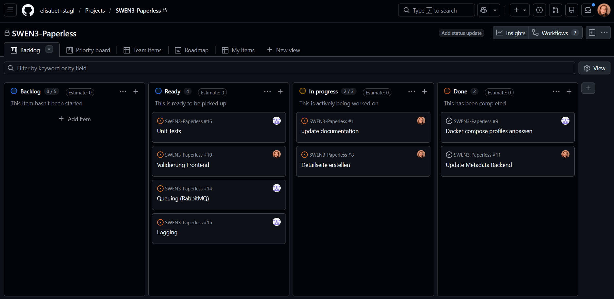

# Paperless – Document Management System

Semester project for **Software Engineering 3 (SWEN3)** at FH Technikum Wien.

Paperless is a document management system that allows users to upload, manage, search, and process PDF documents. Documents are persisted in PostgreSQL and will later be processed using OCR, full-text search, and AI-generated summaries.

### Team members:
* Jandl Maximilian
* Stagl Elisabeth

---

# Technology Stack

| Technology | Purpose |
|------------|---------|
| Java 25 | Programming language |
| Spring Boot 4 | Backend framework |
| Spring Web MVC | REST API |
| Spring Data JPA | Persistence / repository abstraction |
| Hibernate | ORM |
| PostgreSQL | Relational database |
| Maven | Build and dependency management |
| Docker | Containerization |
| Docker Compose | Local infrastructure |
| JUnit | Unit testing |
| Mockito | Mocking dependencies in unit tests |
| iText | PDF metadata extraction |
| Lombok | Reduction of Java boilerplate |
| Bruno / Postman | Manual REST API testing |
| Angular | Frontend framework |
| Angular Material | UI components, dialogs, and notifications |

Additional technologies such as RabbitMQ, MinIO, Elasticsearch, OCR, and GenAI will be integrated in later sprints.

---

## Project Structure

### Backend Structure

The backend structure shown below represents the current state of the project.
```text
backend/src/main/java/at/fhtw/backend/
├── business/               # Business logic / services
├── dto/                    # DTOs
├── mapper/                 # Mappers (using MapStruct)
├── presentation/           # REST controllers
├── model/                  # JPA entities
├── persistence/            # Data Access Layer / repositories
└── BackendApplication.java
```
---

## Configuration

Sensitive configuration data, such as database credentials, is stored in a local `.env` file. This file is excluded from Git to prevent passwords and other sensitive values from being committed to the repository.

An `.env.example` file is provided as a template and contains all required environment variables without sensitive values. To configure the application locally, copy `.env.example` to `.env` and fill in the appropriate values.

---
## Running the Application

### 1. Configure Environment Variables

The project contains an `.env.example` file with the required environment variables.

Create a copy of `.env.example` and rename it to:

```text
.env
```

Fill in the required values in the `.env` file. The `.env` file contains local configuration such as database credentials and is excluded from Git.

### 2. Start the Application

From the project root directory, start the complete application and its required infrastructure using Docker Compose:

```bash
docker compose up -d
```

This starts all required containers, including the Angular frontend, Spring Boot backend, and PostgreSQL database.

Once the containers are running, the application is available at:
- Frontend: http://localhost
- Backend REST API: http://localhost:8081/api/documents

### 3. Test the REST API

A Postman collection is included in the project for testing the available REST endpoints.

Import the provided Postman collection into Postman. The collection contains requests for the document and note endpoints and can be used to manually test the REST API after the application has started.

### 4. Stop the Application

To stop and remove the containers started by Docker Compose, run:

```bash
docker compose down
```

To start the application again, run:

```bash
docker compose up -d
```

---

# REST API

Base path:

```text
/api/documents
```

## Document Endpoints

| Method | Endpoint | Description                                               |
|--------|----------|-----------------------------------------------------------|
| `GET` | `/api/documents` | Get all documents                                         |
| `GET` | `/api/documents/{id}` | Get document by ID                                        |
| `POST` | `/api/documents` | Upload a PDF document                                     |
| `PUT` | `/api/documents/{id}` | Update a document (fields like author, creator, title,..) |
| `DELETE` | `/api/documents/{id}` | Delete a document                                         |


## Note Endpoints

| Method | Endpoint                                      | Description |
|--------|-----------------------------------------------|-------------|
| `GET` | `/api/documents/{documentId}/notes`           | Get all notes for a document |
| `GET` | `/api/documents/{documentId}/notes/{noteId}`  | Get a note by ID |
| `POST` | `/api/documents/{documentId}/notes`          | Add a note to a document |
| `PUT` | `/api/documents/{documentId}/notes/{noteId}`  | Update a note |
| `DELETE` | `/api/documents/{documentId}/notes/{noteId}` | Delete a note |


---

# Frontend

The application includes an Angular frontend that provides a user-friendly interface for managing PDF documents and their associated notes.

Angular Material is used for UI components such as cards, buttons, tooltips, dialogs, and snackbars.

## Features

- **Document Overview:** Display uploaded documents in a card-based layout.
- **PDF Upload:** Upload PDF documents with client-side validation.
- **Document Details:** View document information and associated notes.
- **Note Management:** Create, view, edit, and delete notes associated with documents.

## Frontend Architecture

The frontend is organized into components, services, and models.

- **Components:** Handle the user interface and user interactions.
- **API Services:** Communicate with the Spring Boot REST API.
- **DocumentStore:** Manages document state using Angular Signals.
- **NotificationService:** Provides consistent success and error messages throughout the application.

The frontend communicates with the backend through HTTP requests.


---

# Validation and Error Handling

The application implements validation on both the frontend and backend to prevent invalid data from being processed.

## Document Validation

- Only PDF files are accepted for upload.
- The maximum upload size is 10 MB.
- Document metadata is validated using Jakarta Bean Validation.
- Required fields must not be empty.
- Text fields are restricted to their configured maximum lengths.
- The number of pages must be at least 1.

## Note Validation

- Notes must not be empty or contain only whitespace.
- Notes are limited to a maximum of 500 characters.
- Validation is applied when creating and updating notes.
- The backend validates incoming requests using `@Valid`, `@NotBlank`, and `@Size`.

## Error Handling

The Spring Boot backend uses a global exception handler to return appropriate HTTP status codes and error responses.

Examples include:

- `400 Bad Request` for invalid input.
- `404 Not Found` for resources that do not exist.
- `413 Payload Too Large` for files exceeding the upload size limit.

The Angular frontend displays feedback through Angular Material snackbars. Successful operations are indicated by success messages, while failed operations display error messages.

---

# Testing
## Unit Tests

Unit tests are implemented using:

- JUnit
- Mockito

The production database is not accessed by the service unit tests. Instead, DocumentRepository, NoteRepository, and the corresponding mappers are mocked.

This allows the business logic to be tested independently of PostgreSQL.

### DocumentService Tests

Current unit tests cover:

- retrieving all documents
- retrieving an existing document
- retrieving a non-existing document
- deleting an existing document
- deleting a non-existing document

### NoteService Tests

Current unit tests cover:

- retrieving all notes for a document
- retrieving an existing note
- retrieving a non-existing note
- handling a note that belongs to a different document
- adding a note to an existing document
- handling note creation for a non-existing document
- updating an existing note
- deleting an existing note
- deleting a non-existing note

### Mapper Tests

Mapper functionality is tested separately using the actual MapStruct mapper implementations.

These tests verify:

- conversion from entities to DTOs
- conversion from DTOs to entities
- update mappings
- fields that are intentionally ignored during mapping
---

# Additional Use Case

Users can add notes to their files.

## Description


The additional use case allows users to create and manage notes associated with their documents. A document can have multiple notes, which can be used to store comments, reminders, or other additional information related to the document.

Each note is stored as a separate entity and is associated with a specific document. Users can create, view, update, and delete notes.

---

# GitHub Kanban Board

To organize and track our tasks efficiently, we use a GitHub Project Kanban board. Each task is created as a GitHub Issue and assigned to a team member to ensure clear responsibilities. Issues are moved between different columns based on their current status, allowing the team to monitor progress and see who is working on what.



---

# Branching Strategy and Workflow

We follow a feature-based branching strategy to keep our development process organized. The development branch serves as the main integration branch, while the main branch contains the completed work from each sprint.

For each new feature or issue, we create a separate branch based on development. Once the implementation is complete, a Pull Request is created to merge the changes back into development.

At the end of each sprint, we merge development into main to incorporate all completed features. We also clean up outdated or unused branches to keep the repository organized and maintainable.


# CI/CD Pipeline

We use GitHub Actions to automate parts of our development workflow. Our current pipeline packages the project into a ZIP archive, making it easier to distribute and access the project files.

The workflow is managed directly through GitHub Actions and helps ensure a consistent packaging process.

We plan to add automated testing, linting, and other checks to our CI/CD pipeline in the future to improve code quality and make development easier.

---
# Lessons Learned 

During this project, we learned how important good organization and a clear project structure are when working in a team. Clear responsibilities and regular communication help everyone stay informed and make collaboration more efficient.

Using GitHub Issues, Pull Requests, and a Kanban board made it easier to organize tasks, track progress, and keep an overview of the current project status. This also helped us understand what other team members were working on.

Another important lesson was the importance of validation and user feedback. Validation helps prevent invalid data and unexpected errors, while clear success and error messages allow users to understand what is happening in the application. Features such as notifications and confirmation dialogs make the application more user-friendly and easier to use.

---

# Tracked Time

## Elisabeth Stagl

### Sprint 1

| Task / Feature                                    | Time (h) |
|---------------------------------------------------|:--------:|
| Git Repository Setup and Spring Boot Integration  |   0.5    |
| Docker Setup                                      |   2.0    |
| Small Changes                                     |   0.5    |
| Additional Use Case                               |   1.0    |
| DTOs and Mappers, changes in Service + Controller |   3.0    |
| Added/changed tests + Test for Mappers            |   2.5    |
| Protocol / Project Specification                  |   2.0    |
| **Subtotal**                                      | **11.5** |

### Sprint 2

| Task / Feature                        | Time (h) |
|---------------------------------------|:--------:|
| Frontend Setup + Styling              |   3.0    |
| Frontend Styling                      |   2.0    |
| Validation + Styling                  |   5.5    |
| Changed Document Update method        |   1.0    |
| Detail page                           |   3.0    |
| More validation + snackbar and dialog |   3.5    |
| Protocol / Project Specification      |   1.5    |
| **Subtotal**                          | **19.5** |

### Sprint 3

| Task / Feature                   | Time (h) |
|----------------------------------|:--------:|
| Protocol / Project Specification |   0.0    |
| **Subtotal**                     | **0.0**  |

## Maximilian Jandl

### Sprint 1

| Task / Feature                                   | Time (h) |
|--------------------------------------------------|:--------:|
| Git Repository Setup and Spring Boot Integration |   0.5    |
| Docker Setup                                     |   2.0    |
| Small Changes                                    |   0.5    |
| Additional Use Case                              |   1.0    |
| Protocol / Project Specification                 |   1.0    |
| **Subtotal**                                     | **0.0**  |